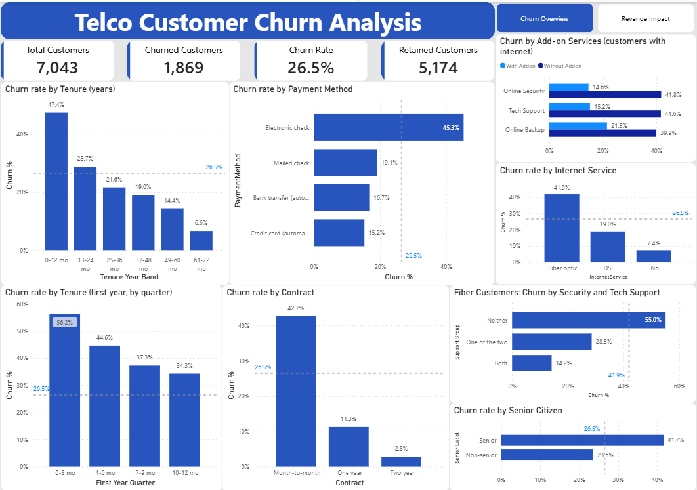
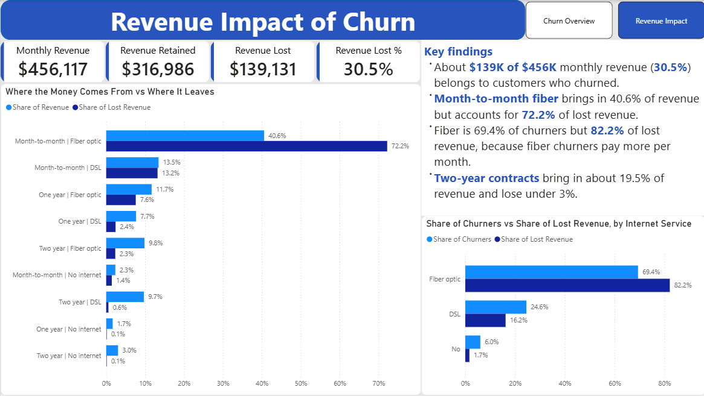

# Telco Customer Churn: EDA and Power BI Dashboard

An end-to-end analysis of customer churn for a fictional telecom company: **who leaves, what it costs, and what to do about it.** The analysis is done in Python (Jupyter) and the findings are presented in a two-page Power BI dashboard.




## Project at a glance

| | |
|---|---|
| **Dataset** | IBM Telco Customer Churn sample: 7,043 customers, 21 columns |
| **Tools** | Python (pandas, matplotlib), Jupyter Notebook, Power BI Desktop (DAX) |
| **Question** | Which customers churn, why might they, and how much revenue is at stake? |
| **Headline** | **26.5%** of customers churned, taking about **$139K (30.5%)** of **$456K** monthly revenue with them |

## Key findings

**Who churns**
- **Contract is the strongest signal.** Month-to-month customers churn at **42.7%** versus **2.8%** on two-year contracts. They are 55% of customers but **88.6% of all churners**, and the gap holds within every tenure band.
- **The first year is the danger zone.** Churn is **47.4%** in the first 12 months and **56.2%** in the first 3 months, falling to **6.6%** after year five.
- **Fiber optic churns at 41.9%** versus 19.0% for DSL. It is 44% of customers but 69.4% of churners, and it stays the worst within every contract type.
- **Electronic check customers churn at 45.3%**, versus 15-19% for every other payment method.
- **Security and tech support go with much lower churn.** Among customers with internet, churn is about 15% with either one versus about 42% without. Among fiber customers, churn is **55.0%** with neither and **14.2%** with both.
- **Moderate signals:** paperless billing (33.6% vs 16.3%, and 9-17 points higher within every payment method), dependents (15.5% vs 31.3%), and senior citizens (41.7% vs 23.6%).
- **No signal:** gender (26.9% vs 26.2%), phone service, and streaming services.

**What it costs**
- About **$139K of $456K** in monthly revenue (**30.5%**) belongs to customers who churned. Churners pay more per month ($74 vs $61), so their share of revenue is higher than their share of customers.
- **Month-to-month fiber** is both the biggest group and the biggest leak: **40.6%** of all revenue but **72.2%** of lost revenue.
- Fiber is 69.4% of churners but **82.2%** of lost revenue, because fiber churners pay about $88 a month versus $49 for DSL.
- **Two-year contracts** bring in about 19.5% of revenue and account for under 3% of the loss.

## Recommendations

These follow the patterns in the data. Because the data is observational, each one should be tested (for example with a pilot) before a wide rollout.

1. **Focus retention on the first 90 days.** About a third of all churn comes from customers in their first 3 months.
2. **Move month-to-month customers onto longer contracts**, starting with fiber customers.
3. **Bundle or offer security and tech support**, especially to fiber customers on month-to-month plans.
4. **Review the fiber product's price-to-value.** It is the highest-churn product in every contract type and where most revenue is lost.
5. **Look at the electronic check and paperless billing experience**, and consider nudging customers toward automatic payment.
6. **Do not target by gender or phone service.** They show no signal.

## How the analysis was done

1. **Cleaning.** No nulls or duplicates. `TotalCharges` was stored as text with 11 blanks (all customers with tenure 0, not yet billed), converted to numbers with the blanks set to 0. `SeniorCitizen` was converted from 0/1 to Yes/No. "No internet service" and "No phone service" were **kept as separate categories**: merging them with "No" would mix customers who cannot have an add-on with customers who declined it, and would understate churn among those who declined.
2. **Churn by every column.** Each column was compared against the 26.5% baseline using churn *rate* (not raw counts), alongside each group's share of customers versus share of churners.
3. **Checking for confounders.** Whenever a pattern looked strong, it was re-checked *within* another group (for example, fiber within each contract type, or tech support within month-to-month only). Several patterns shrank or disappeared: `Partner` was mostly contract in disguise, `DeviceProtection` mostly disappeared, and `MultipleLines` looked worse overall but reversed once internet type was held fixed (a Simpson's paradox).
4. **Revenue impact.** Lost revenue was calculated from the monthly bills of churned customers and broken down by contract and internet type.

## The dashboard

**Page 1: Churn Overview.** Baseline cards (total, churned, retained, churn rate) and charts for tenure (by year and by quarter of the first year), contract, internet service, payment method, senior citizens, security and tech support add-ons, and the fiber add-ons comparison. Each chart carries a dashed line at the 26.5% overall rate.

**Page 2: Revenue Impact.** Monthly revenue, retained, lost, and % lost; a chart comparing each contract and internet segment's share of revenue to its share of lost revenue; and a chart of share of churners versus share of lost revenue by internet type.

## Repository contents

```
customer_churn_analysis/
├── README.md
├── data/
│   └── WA_Fn-UseC_-Telco-Customer-Churn.csv   # source data
├── notebook/
│   └── customer_churn_analysis.ipynb          # EDA with code, outputs and commentary
└── dashboard/
    ├── CustomerChurnDashboard.pbix            # Power BI dashboard
    └── screenshot/
        ├── images_churn_overview.png          # page 1
        └── images_revenue_impact.png          # page 2
```

## Limitations

- **Associations, not causes.** The data has no reasons for leaving, so the findings describe who churns, not why. Customers who choose add-ons, for example, may simply be more committed to begin with.
- **No dates.** Tenure is the closest thing to time, and the data is a snapshot, so it cannot show how a given signup cohort behaves over time. The first-year charts describe *current customers* by tenure, not the fate of new signups.
- **Revenue is a snapshot.** Lost revenue is what churned customers were paying per month. It is not a forecast of annual loss, and there is no cost data, so profit cannot be measured.
- **Overlapping variables.** Contract, tenure, internet type, and add-ons are tangled together. The main overlaps were checked pair by pair, but no multivariate model was fitted.
- **Senior citizens** churn more, but about 73% of them are on fiber, which explains part of the gap. Within the same internet type they still churn about 7-12 points more. Age is also not something a company can act on, so it is shown as a descriptive finding.
- **Small groups** (for example, two-year contracts in the first two years) give unstable rates and were not over-interpreted.

## Possible next steps

- Rank the highest-risk combinations (for example, month-to-month + fiber + electronic check + no support).
- Fit a simple churn prediction model using the cleaned columns.
- Add slicers to the dashboard (contract, internet service, payment method).

## Data source

The IBM Telco Customer Churn sample dataset, a public sample commonly distributed through Kaggle and IBM's sample data. All customers in it are fictional.
